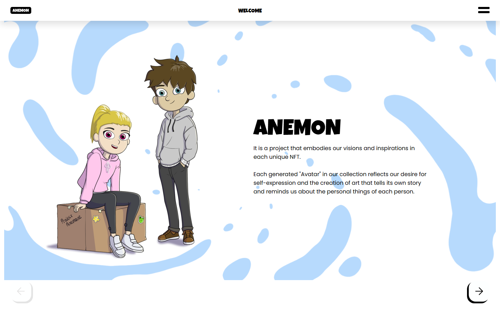
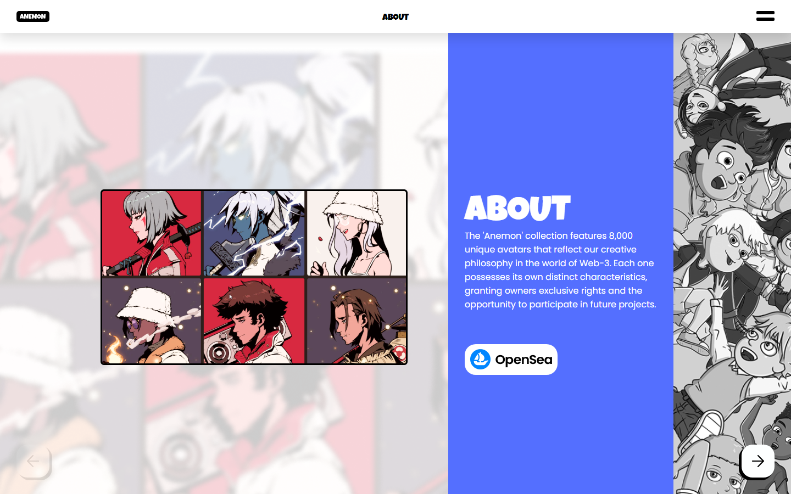
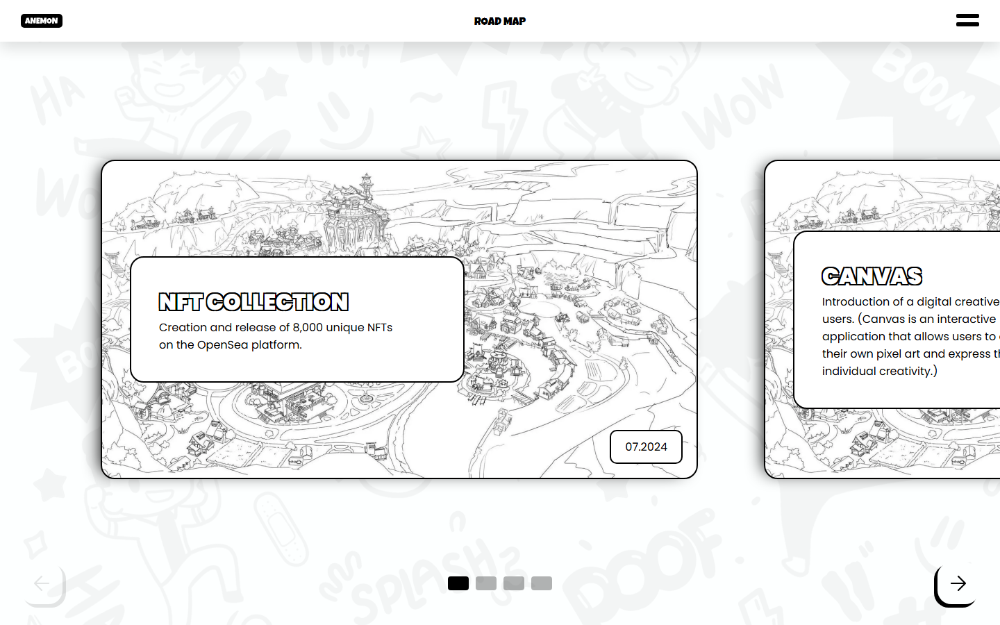

# Anemon

Промо-сайт NFT-коллекции **Anemon**: 8 000 уникальных аватаров-персонажей со своими историями.
Сайт знакомит с проектом через иллюстрированные страницы: Welcome, About, Manifesto (диалог с персонажем), Road Map и Terms & Conditions. Навигация - стрелками внизу экрана и через выпадающее меню; вёрстка адаптивная (от 360 px до 1920 px).



| About | Road Map |
|---|---|
|  |  |

## Стек

- **Python 3 / Django** - маршрутизация и шаблоны страниц
- **HTML, CSS, JavaScript** (без фреймворков) - вёрстка, анимации, слайдер, меню
- **python-dotenv** - настройки и секретный ключ из файла `.env`

## Как запустить

```bash
git clone https://github.com/daststap/anemon_site.git
cd anemon_site

python -m venv venv
venv\Scripts\activate          # Windows
# source venv/bin/activate     # macOS / Linux

pip install -r requirements.txt
```

Создайте файл настроек из шаблона и впишите в него свой `DJANGO_SECRET_KEY`
(для локального запуска также поставьте `DJANGO_DEBUG=True`, иначе Django не будет отдавать статику):

```bash
cd escape_site
copy .env.example .env         # Windows
# cp .env.example .env         # macOS / Linux
```

Запуск:

```bash
python manage.py migrate
python manage.py runserver
```

Сайт откроется на http://127.0.0.1:8000/

## Структура

```
escape_site/
├── manage.py
├── .env.example          # шаблон настроек
├── escape_site/          # настройки проекта (settings.py, urls.py)
└── escape/               # приложение сайта
    ├── views.py
    ├── template/         # HTML-шаблоны страниц
    └── static/           # css, js, img
```
